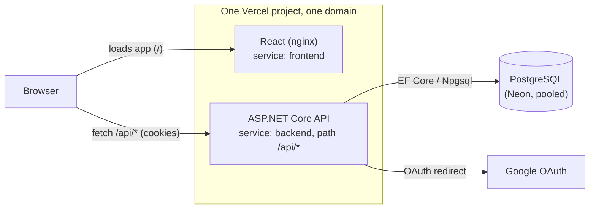

# ShepherdMeet

A full-stack appointment scheduler for booking one-on-one meetings with a parish priest — Google sign-in, a live availability calendar, and an admin panel for managing open slots.

**Live demo:** [shepherdmeet.vercel.app](https://shepherdmeet.vercel.app) — click **Demo as Parishioner** or **Demo as Priest (Admin)** to sign in instantly, no account needed.

> ⏱️ Measured after a genuine 16-minute idle period: first request **~2.5s**, immediate follow-up **~0.27s**. No more 30–60s Render free-tier wake-up.


<!-- TODO: add a screenshot or short GIF of the booking flow and admin panel -->

---

## Features

- **Google Sign-In** — one-click OAuth 2.0 authentication, no passwords
- **Instant demo logins** — try the app as a parishioner or as the admin without signing up
- **Appointment booking** — browse open slots on a calendar and book a 30-minute meeting
- **Admin panel** — the priest manages availability: add time ranges, block off days, set recurring hours
- **Role-based views** — admins see the availability manager; everyone else sees the booking calendar
- **Light / dark mode** — theme toggle with system-preference detection

---

## Tech Stack

| Layer | Technology |
|---|---|
| Frontend | React 18, React Router v6 |
| Backend | ASP.NET Core (.NET 8) Minimal APIs |
| Database | PostgreSQL (Neon) + Entity Framework Core 8 |
| Authentication | Google OAuth 2.0 (cookie-based sessions) + demo login |
| Containerization | Docker, Docker Compose |
| Hosting | Vercel (container runtime, two services in one project) |
| CI | GitHub Actions (build + test) |

### Architecture

Frontend and backend deploy as two container-runtime **services** in a single Vercel project, both reachable through one domain: a top-level rewrite sends `/api/*` to the backend and everything else to the frontend, so the browser only ever talks to one origin. That makes the auth cookie first-party (no CORS, no cross-site `SameSite=None`).



---

## Project Structure

```
ShepherdMeet/
├── backend/                  # ASP.NET Core API
│   ├── Models/                # EF Core entity models
│   ├── Migrations/            # EF Core database migrations (Postgres)
│   ├── Program.cs             # Minimal API endpoints & middleware
│   ├── AppDbContext.cs
│   ├── ShepherdMeet.csproj
│   ├── appsettings.json
│   └── Dockerfile
├── frontend/                  # React application
│   ├── src/
│   │   ├── App.js             # Root component + auth gate + role routing
│   │   ├── login.js           # Google sign-in + demo-login screen
│   │   ├── UserForm.js        # Appointment booking calendar
│   │   ├── PriestAvailabilityForm.js  # Admin availability manager
│   │   ├── ConfirmationPage.js
│   │   └── WeeklyAvailabilityForm.js
│   ├── public/
│   ├── package.json
│   └── Dockerfile
├── docker-compose.yml          # Local dev: both services + Postgres + one-off migrate
├── vercel.json                 # Vercel services + rewrites (infra-as-code)
└── .github/workflows/
    └── ci.yml                  # Build + test on PRs and pushes
```

---

## Local Development

### Prerequisites

- [.NET 8 SDK](https://dotnet.microsoft.com/download)
- [Node.js 20+](https://nodejs.org)
- [Docker Desktop](https://www.docker.com/products/docker-desktop)
- A Google OAuth Client ID & Secret ([Google Cloud Console](https://console.cloud.google.com)) — optional; the demo logins work without it

### Option A — Docker Compose (recommended)

Spins up the API, the frontend, and a local Postgres container together.

```bash
git clone https://github.com/alexmekhail/ShepherdMeet.git
cd ShepherdMeet

cp .env.example .env   # fill in Google credentials, or leave as-is and use demo login

docker compose up --build
```

- Frontend: `http://localhost:3000`
- Backend: `http://localhost:5209` (all routes are under `/api`, e.g. `http://localhost:5209/api/health`)

A one-off `migrate` service applies EF Core migrations before `backend` starts (migrations are never run by the app itself — see [Database](#database)). Demo-account and sample-availability seeding still happens on backend startup; it's idempotent and a no-op once seeded.

### Option B — Run services individually

**Start Postgres** (or point at any local Postgres instance — just match `appsettings.Development.json`):
```bash
docker run -d --name shepherdmeet-pg -e POSTGRES_DB=shepherdmeet -e POSTGRES_USER=postgres -e POSTGRES_PASSWORD=postgres -p 5433:5432 postgres:16-alpine
```

**Backend:**
```bash
cd backend

# Optional, for real Google sign-in:
dotnet user-secrets set "Authentication:Google:ClientId" "<your-client-id>"
dotnet user-secrets set "Authentication:Google:ClientSecret" "<your-client-secret>"

# Apply migrations once (not run automatically — see Database below):
dotnet run -- --migrate

dotnet run
```

**Frontend:**
```bash
cd frontend
cp .env.example .env          # REACT_APP_API_URL=http://localhost:5209/api
npm install
npm start
```

### Google OAuth redirect URIs (for local dev)

Add these to your Google Cloud Console OAuth client:
- Authorized JavaScript origin: `http://localhost:3000`
- Authorized redirect URI: `http://localhost:5209/api/signin-google`

---

## Database

PostgreSQL via Entity Framework Core, hosted on [Neon](https://neon.tech)'s free tier, connected through Neon's **pooled** (PgBouncer) endpoint — the hostname containing `-pooler` — so bursts of connections from a cold-started container don't exhaust Neon's connection limit. The Npgsql pool itself is sized small (`MaxPoolSize=10`, `MinPoolSize=0`) since each container instance keeps its own pool.

Migrations are **not** applied on backend startup — a container that's cold-starting shouldn't also be blocked on schema work. Apply them as an explicit step instead, against `ConnectionStrings__DefaultConnection`:
```bash
dotnet ShepherdMeet.dll --migrate
```
(`docker-compose.yml`'s `migrate` service runs exactly this before `backend` starts, for local dev.)

To create a new migration after model changes:
```bash
cd backend
dotnet ef migrations add <MigrationName>
```

### Demo data

On first boot, the backend seeds:
- Randomized priest availability slots through the end of the year
- Two demo accounts (parishioner + admin) with no personal data
- A couple of sample appointments for the demo parishioner

---

## Deployment

Hosting is defined as code in [`vercel.json`](vercel.json): one Vercel project with two container-runtime **services**,
routed through a single domain via rewrites —

- **`backend`** — built from `backend/Dockerfile`, reachable at `/api/*`. Vercel's container-runtime services forward the request path as-is (no path-stripping transform like framework-native functions get), so every ASP.NET route is itself grouped under `/api` (`app.MapGroup("/api")` in [Program.cs](backend/Program.cs)) to match.
- **`frontend`** — built from `frontend/Dockerfile` (nginx), reachable at everything else

Because both services share one domain, the frontend and API are **same-origin** in production — no CORS, no cross-site cookies. This also removes the old circular "URLs are only known after the first deploy" problem: the frontend's API base URL is just the relative path `/api`, baked into [frontend/Dockerfile](frontend/Dockerfile) as a build `ARG` default (**not** a Vercel project env var — Create React App bakes `REACT_APP_API_URL` in at `npm run build` time, and Vercel's container builder doesn't pass project env vars through as Docker build-args, so setting it in the Vercel dashboard has no effect).

The auth cookie's encryption key (ASP.NET's DataProtection key ring) is persisted to Postgres (`PersistKeysToDbContext` in [Program.cs](backend/Program.cs)), not left at its ephemeral per-instance default — otherwise a cookie issued by one container instance fails to decrypt on another once the platform scales out or recycles an instance, which surfaced as logins that worked once and then randomly 401'd.

Vercel deploys from Git automatically; there's no deploy step in CI.

### Setup checklist (one-time, manual)

1. **Create a Neon project** at [neon.tech](https://neon.tech) if you haven't, and copy its **pooled** connection string (the `-pooler` hostname variant, `postgres://...`).
2. **Run migrations once** against that connection string (`dotnet ShepherdMeet.dll --migrate` — see [Database](#database)). Re-run after any migration that ships in a later deploy.
3. **In Vercel**, import this repo as a new project (it reads `vercel.json` automatically) and set, as project env vars:
   | Env var | Value |
   |---|---|
   | `ConnectionStrings__DefaultConnection` | the Neon pooled connection string |
   | `FrontendUrl` | empty string — post-login redirects to `/` (root-relative; always correct, same-origin) |
   | `Authentication__Google__ClientId` / `...ClientSecret` | optional, only for real Google sign-in |
   | `AdminEmails` | optional, only to override the built-in admin list |

   `REACT_APP_API_URL` is **not** set here — it's baked into the frontend Docker image at build time (see above), and a Vercel project env var of that name has no effect.
4. (Optional) For real Google sign-in in production, add the deployed domain as an authorized JavaScript origin and `<domain>/api/signin-google` as an authorized redirect URI in the Google Cloud Console.

### Environment Variables

**Backend**

| Variable | Description | Default |
|---|---|---|
| `ConnectionStrings__DefaultConnection` | Postgres connection string — use Neon's **pooled** URI in production (accepts a native Npgsql string too) | — |
| `PORT` | Port Kestrel binds to | set automatically by the hosting platform |
| `Authentication__Google__ClientId` / `...ClientSecret` | Google OAuth credentials (optional) | — |
| `AllowedOrigins` | Comma-separated CORS origins (only exercised by cross-origin local dev; same-origin in production) | `http://localhost:3000` |
| `FrontendUrl` | Post-login redirect base URL — set to an empty string in production (root-relative redirect, same-origin) | `http://localhost:3000` |
| `AdminEmails` | Comma-separated emails with admin access | two real admin emails + the seeded demo admin |

**Frontend**

Not a runtime env var — Create React App bakes `REACT_APP_API_URL` into the JS bundle at Docker build time, and Vercel's container builder doesn't pass project env vars through as build-args. It's a build `ARG` in [frontend/Dockerfile](frontend/Dockerfile):

| Variable | Description | Default (used in production) |
|---|---|---|
| `REACT_APP_API_URL` | Backend API base URL, baked in at `npm run build` time | `/api` |

Override it locally with `docker build --build-arg REACT_APP_API_URL=... ` or (what `docker-compose.yml` does) the Compose `args:` key, if the backend isn't at the same origin — e.g. local dev uses `http://localhost:5209/api`.

---

## Hosting history

This app originally ran on **Azure Container Apps** with images built and pushed to **Azure Container Registry** via GitHub Actions, backed by SQLite on an Azure Files mount. It then moved to **Render + Neon Postgres** to bring hosting cost down to $0/month, and has since moved again to **Vercel's container runtime + Neon Postgres** — same $0/month cost, but without Render free-tier's cold-start sleep. The app is no longer in active production use; it exists as a portfolio piece.
