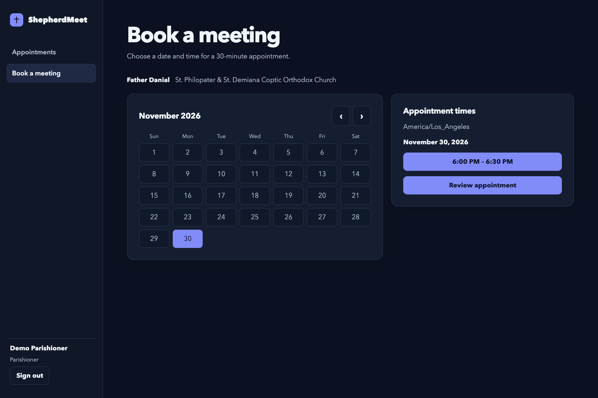
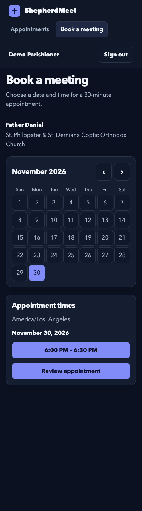
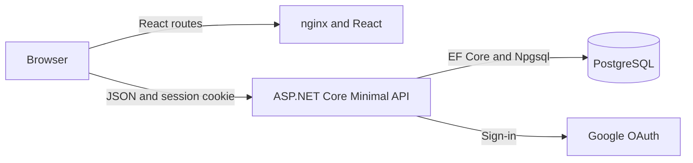

# ShepherdMeet

ShepherdMeet is a parish scheduling application for 30-minute appointments
with Father Danial at St. Philopater & St. Demiana Coptic Orthodox Church.
Parishioners can find a time, review and confirm an appointment, and cancel
from their appointment dashboard. Schedule administrators can open or block
hours for a given date or repeat a weekly pattern through a chosen end date.

## Screenshots

These captures use a disposable local PostgreSQL database and demo accounts.

| Desktop booking | Mobile booking |
| --- | --- |
|  |  |

[Appointment dashboard](docs/appointments-desktop.png) ·
[Availability editor](docs/availability-desktop.png)

## Architecture

React 18 and React Router render the client with plain CSS and component-local
state. Create React App builds the static bundle, which nginx serves in the
frontend container. ASP.NET Core 8 Minimal APIs use Entity Framework Core and
Npgsql against PostgreSQL 16. The existing Vercel configuration routes
`/api/*` to the backend and all other paths to the frontend on the same origin.



### Starting point and regression risks

The original root rendered the booking calendar or availability editor based on
the profile response. Appointment history lived in a sidebar. The confirmation
page posted client-provided appointment fields and then issued a separate slot
deletion. PostgreSQL had no appointment-to-slot relation or overlap constraint.
Availability timestamps represented church wall time, while appointment dates
and times were strings. The old booking UI omitted AM/PM, making some existing
appointment times ambiguous.

The availability API expanded only the first matching occurrence of each
weekday in a date range. The weekly form was unreachable, and the editor
attempted a PUT route the API did not provide. Google sessions used cookies
with PostgreSQL-backed Data Protection keys. Availability writes did not
consistently check the administrator allowlist. CI built both projects and
allowed the frontend test step to pass with zero tests. There was no backend
test suite.

Booking confirmation now requires a slot ID, so frontend and backend need a
coordinated rollout. Local demo authentication remains available. A hosted
demo and real appointments require separate databases and deployments.

## Local development

Install Docker Desktop, or use .NET 8, Node.js 20, npm, and PostgreSQL 16 for
standalone development.

```sh
cp .env.example .env
docker compose up --build
```

Open [the local web app](http://localhost:3000). The API listens on port 5209
and PostgreSQL on port 5433. The Compose migration service runs before the API.
Local development enables demo sign-in and sample data. Google configuration
is optional for local demo use.

For standalone development, point the API at a **local** database. Pre-create
the database, then migrate and run the server from the repository root.

```sh
export ASPNETCORE_ENVIRONMENT=Development
export PORT=5209
export ConnectionStrings__DefaultConnection='Host=localhost;Port=5433;Database=shepherdmeet;Username=postgres;Password=postgres'
dotnet run --project backend -- --migrate
dotnet run --project backend
```

In another terminal:

```sh
cd frontend
npm ci
npm start
```

### Configuration

| Setting | Purpose |
| --- | --- |
| `ConnectionStrings__DefaultConnection` | Npgsql connection string or PostgreSQL URL. Use the target environment's secret store. |
| `Authentication__Google__ClientId`, `Authentication__Google__ClientSecret` | Google OAuth credentials. Register `<API origin>/api/signin-google`. |
| `FrontendUrl`, `AllowedOrigins` | Frontend redirect URL and comma-separated trusted browser origins. |
| `AdminEmails` | Comma-separated Google account emails authorized to manage the church schedule. Configure before rollout. |
| `AccountAdminEmails` | Separate comma-separated Google account emails authorized for account management. Defaults to empty. |
| `Scheduling__TimeZone` | IANA timezone used for the church schedule. Defaults to `America/Los_Angeles`. |
| `Demo__Enabled` | Defaults on in Development and off elsewhere. Enable only on an isolated demo database. |
| `REACT_APP_API_URL` | Client build-time API base. Standalone default is `http://localhost:5209/api`; container default is `/api`. |

## Authentication and authorization

Google OAuth returns users to a cookie session. Production cookies are
HttpOnly, Secure, and SameSite=Lax. PostgreSQL stores the Data Protection key
ring so sessions survive across instances. Browser requests with an untrusted
Origin cannot change state. The API enforces the administrator allowlist for
schedule changes and scopes appointment reads and cancellation to the signed-in
owner. All `/api/users` endpoints require explicit membership in
`AccountAdminEmails`. Schedule administrator access alone grants no account
permissions. The public calendar returns times and booking states without appointment
owners or attendee details.

Development and isolated demos support preseeded parishioner and admin
sessions. Demo accounts share their data with other visitors to that demo.
Disabling demo mode blocks demo sign-in and invalidates demo sessions. Demo
administrators can edit the demo schedule. They have no access to the account
management endpoints.

## Booking integrity and time handling

The server reads the selected availability record, derives attendee and
appointment fields, and validates the date, duration, and any blocks. Booking,
cancellation, and availability writes serialize inside a transaction through a
PostgreSQL advisory lock on the shared schedule. A unique slot index and a
PostgreSQL exclusion constraint enforce the database invariant for new bookings.
Half-open intervals allow a new appointment to start when another ends. A race
or stale selection receives HTTP 409. Cancellation removes the appointment
while retaining the original slot and any administrator block.

Availability is entered and displayed in church local time. New appointments
store the exact start and end instants as PostgreSQL timestamps with time zone.
Opening hours that include skipped or ambiguous daylight-saving times are
rejected. Bounded weekly hours expand into dated slots, and dated blocks take
precedence over repeated openings. Open a single date explicitly to restore
blocked intervals on that date.

### Migration and rollout

`20261127180000_ProtectAppointmentSlots` adds nullable metadata so legacy rows
remain readable. The new constraints cover rows with a slot reference and UTC
interval. Legacy start times without AM/PM are treated as potentially matching
either interpretation. Unknown legacy times conservatively block that date
until reconciled. A canceled legacy appointment releases any matching existing
slots. If the old confirmation flow deleted its slot, an administrator must
open that time again.

Apply the migration to a backed-up staging database first and check upcoming
legacy bookings. Run the migration explicitly with `dotnet ShepherdMeet.dll
--migrate`. Pause booking writes during the schema and frontend/API transition
so the previous API cannot keep inserting legacy rows. The down migration
drops the new links and instants, so retain a database backup for rollback.

## Tests

```sh
cd frontend
npm ci
npm test -- --watchAll=false --runInBand
npx --no-install eslint src --ext .js
CI=true npm run build
```

The frontend uses JavaScript. There is no TypeScript project to check.

```sh
dotnet restore ShepherdMeet.sln
dotnet build ShepherdMeet.sln --no-restore
```

Start a fresh disposable PostgreSQL database, apply migrations, then run the
API in Development. Run the HTTP integration suite and the direct database
assertions. To verify concurrency across instances, point
`SHEPHERDMEET_SECOND_TEST_URL` at a second API process on the same database.

```sh
SHEPHERDMEET_TEST_URL=http://localhost:5209/api python3 tests/scheduling_integration.py
psql -h localhost -p 5433 -U postgres -d shepherdmeet_test -f tests/appointment_constraints.sql
```

The HTTP tests cover competing bookings, owner-only cancellation, rebooking,
privacy, permission failures, API validation, DST boundaries, midnight, and
availability overrides. The SQL assertions directly verify PostgreSQL rejects
overlapping intervals with different slot IDs and invalid durations. GitHub
Actions runs these tests against its own PostgreSQL service.

## Possible extensions

Priest selection would require a priest directory and a schedule attached to
each priest, with the overlap constraint scoped accordingly. Indefinite
recurrence would require a stored rule and exception model. Both should be
designed before adding controls for them.
