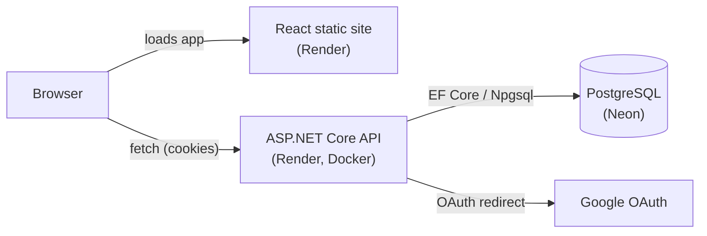

# ShepherdMeet

A full-stack appointment scheduler for booking one-on-one meetings with a parish priest — Google sign-in, a live availability calendar, and an admin panel for managing open slots.

**Live demo:** [shepherdmeet-frontend.onrender.com](https://shepherdmeet-frontend.onrender.com) <!-- TODO: update if Render assigns a different URL — service names are first-come, first-served --> — click **Demo as Parishioner** or **Demo as Priest (Admin)** to sign in instantly, no account needed.

> ⏱️ This runs on free hosting that sleeps after 15 minutes of inactivity. The first load after a while can take **about a minute** to wake back up — the app shows a notice while it does.


<!-- TODO: add a screenshot or short GIF of the booking flow and admin panel -->

---

## Features

- **Google Sign-In** — one-click OAuth 2.0 authentication, no passwords
- **Instant demo logins** — try the app as a parishioner or as the admin without signing up
- **Appointment booking** — browse open slots on a calendar and book a 30-minute meeting
- **Admin panel** — the priest manages availability: add time ranges, block off days, set recurring hours
- **Role-based views** — admins see the availability manager; everyone else sees the booking calendar
- **Light / dark mode** — theme toggle with system-preference detection

---

## Tech Stack

| Layer | Technology |
|---|---|
| Frontend | React 18, React Router v6 |
| Backend | ASP.NET Core (.NET 8) Minimal APIs |
| Database | PostgreSQL (Neon) + Entity Framework Core 8 |
| Authentication | Google OAuth 2.0 (cookie-based sessions) + demo login |
| Containerization | Docker, Docker Compose |
| Hosting | Render (Blueprint / infrastructure-as-code) |
| CI | GitHub Actions (build + test) |

### Architecture



---

## Project Structure

```
ShepherdMeet/
├── backend/                  # ASP.NET Core API
│   ├── Models/                # EF Core entity models
│   ├── Migrations/            # EF Core database migrations (Postgres)
│   ├── Program.cs             # Minimal API endpoints & middleware
│   ├── AppDbContext.cs
│   ├── ShepherdMeet.csproj
│   ├── appsettings.json
│   └── Dockerfile
├── frontend/                  # React application
│   ├── src/
│   │   ├── App.js             # Root component + auth gate + role routing
│   │   ├── login.js           # Google sign-in + demo-login screen
│   │   ├── UserForm.js        # Appointment booking calendar
│   │   ├── PriestAvailabilityForm.js  # Admin availability manager
│   │   ├── ConfirmationPage.js
│   │   └── WeeklyAvailabilityForm.js
│   ├── public/
│   ├── package.json
│   └── Dockerfile
├── docker-compose.yml          # Local dev: both services + Postgres
├── render.yaml                 # Render Blueprint (infra-as-code)
└── .github/workflows/
    └── ci.yml                  # Build + test on PRs and pushes
```

---

## Local Development

### Prerequisites

- [.NET 8 SDK](https://dotnet.microsoft.com/download)
- [Node.js 20+](https://nodejs.org)
- [Docker Desktop](https://www.docker.com/products/docker-desktop)
- A Google OAuth Client ID & Secret ([Google Cloud Console](https://console.cloud.google.com)) — optional; the demo logins work without it

### Option A — Docker Compose (recommended)

Spins up the API, the frontend, and a local Postgres container together.

```bash
git clone https://github.com/alexmekhail/ShepherdMeet.git
cd ShepherdMeet

cp .env.example .env   # fill in Google credentials, or leave as-is and use demo login

docker compose up --build
```

- Frontend: `http://localhost:3000`
- Backend: `http://localhost:5209`

Migrations and seed data (demo accounts + sample availability) apply automatically on first boot.

### Option B — Run services individually

**Start Postgres** (or point at any local Postgres instance — just match `appsettings.Development.json`):
```bash
docker run -d --name shepherdmeet-pg -e POSTGRES_DB=shepherdmeet -e POSTGRES_USER=postgres -e POSTGRES_PASSWORD=postgres -p 5433:5432 postgres:16-alpine
```

**Backend:**
```bash
cd backend

# Optional, for real Google sign-in:
dotnet user-secrets set "Authentication:Google:ClientId" "<your-client-id>"
dotnet user-secrets set "Authentication:Google:ClientSecret" "<your-client-secret>"

dotnet run
```

**Frontend:**
```bash
cd frontend
cp .env.example .env          # REACT_APP_API_URL=http://localhost:5209
npm install
npm start
```

### Google OAuth redirect URIs (for local dev)

Add these to your Google Cloud Console OAuth client:
- Authorized JavaScript origin: `http://localhost:3000`
- Authorized redirect URI: `http://localhost:5209/signin-google`

---

## Database

PostgreSQL via Entity Framework Core, hosted on [Neon](https://neon.tech)'s free tier. Migrations apply automatically on backend startup (`db.Database.Migrate()`) — simplest option for a low-traffic demo app with no separate migration-job infrastructure to maintain.

To create a new migration after model changes:
```bash
cd backend
dotnet ef migrations add <MigrationName>
```

### Demo data

On first boot, the backend seeds:
- Randomized priest availability slots through the end of the year
- Two demo accounts (parishioner + admin) with no personal data
- A couple of sample appointments for the demo parishioner

---

## Deployment

Hosting is defined as code in [`render.yaml`](render.yaml) (a Render **Blueprint**):

- **API** — a Docker web service built from `backend/Dockerfile`, free plan, health-checked at `/health`
- **Frontend** — a static site built from `frontend/`, with an SPA rewrite so client-side routes don't 404

Render auto-deploys both services on every push to `main` — there's no deploy step in CI.

### Setup checklist (one-time, manual)

1. **Create a Neon project** at [neon.tech](https://neon.tech) and copy its connection string (`postgres://...`).
2. **In Render**, create a new Blueprint from this repo (Render reads `render.yaml` automatically).
3. On the **`shepherdmeet-backend`** service, set:
   | Env var | Value |
   |---|---|
   | `ConnectionStrings__DefaultConnection` | the Neon connection string |
   | `AllowedOrigins` | the frontend's Render URL, e.g. `https://shepherdmeet-frontend.onrender.com` |
   | `FrontendUrl` | same as above |
   | `Authentication__Google__ClientId` / `...ClientSecret` | optional, only for real Google sign-in |
4. **On the `shepherdmeet-frontend` service**, set:
   | Env var | Value |
   |---|---|
   | `REACT_APP_API_URL` | the backend's Render URL, e.g. `https://shepherdmeet-backend.onrender.com` |
5. Redeploy both services once the URLs above are known (Render only assigns them after the first deploy, so this one circular step is unavoidable).
6. (Optional) If you want real Google sign-in in production, add the frontend's Render URL as an authorized JavaScript origin and `<backend-url>/signin-google` as an authorized redirect URI in the Google Cloud Console.

### Environment Variables

**Backend**

| Variable | Description | Default |
|---|---|---|
| `ConnectionStrings__DefaultConnection` | Postgres connection string (accepts Neon's `postgres://` URI or a native Npgsql string) | — |
| `PORT` | Port Kestrel binds to | set automatically by Render |
| `Authentication__Google__ClientId` / `...ClientSecret` | Google OAuth credentials (optional) | — |
| `AllowedOrigins` | Comma-separated CORS origins | `http://localhost:3000` |
| `FrontendUrl` | Post-login redirect base URL | `http://localhost:3000` |
| `AdminEmails` | Comma-separated emails with admin access | two real admin emails + the seeded demo admin |

**Frontend**

| Variable | Description | Default |
|---|---|---|
| `REACT_APP_API_URL` | Backend API base URL (baked in at build time) | `http://localhost:5209` |

---

## Hosting history

This app originally ran on **Azure Container Apps** with images built and pushed to **Azure Container Registry** via GitHub Actions, backed by SQLite on an Azure Files mount. It's since migrated to **Render + Neon Postgres** to bring hosting cost down to **$0/month** as a portfolio piece — the app is no longer in active production use.
